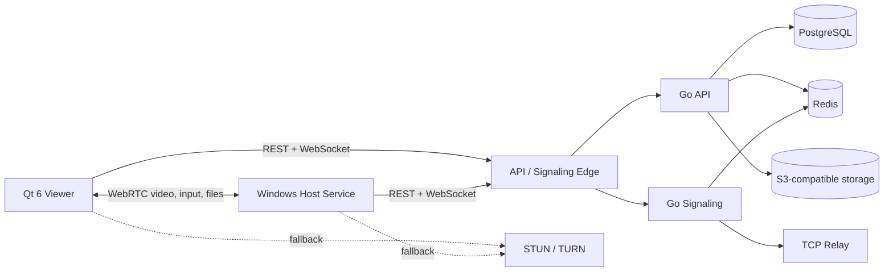

# RemoteX

RemoteX is a Windows remote-support platform built as a production-oriented engineering project. It combines a native C++ host and Qt viewer with a Go control plane for authentication, machine management, signaling, relaying, recordings, backups, and signed updates.

> This repository is a curated portfolio snapshot. Production credentials, deployment configuration, generated binaries, release packages, and operational history are intentionally excluded. The configured `*.example` endpoints are non-routable placeholders.

## Engineering at a glance

- **67k+ lines** of C++, Go, and supporting native code across 273 source files
- **449 automated test cases** covering protocol, security, session, update, transfer, and UI behavior
- Native Windows host, desktop viewer, updater service, REST API, WebSocket signaling, and TCP relay
- WebRTC media and data channels with relay fallback
- Signed update pipeline using Ed25519 and SHA-256 verification
- Multi-tenant backend with JWT authentication, TOTP for administration, audit events, rate limiting, and machine limits
- Session recording, scheduled backup, file transfer, clipboard synchronization, and secure-desktop handling

## Architecture



See [docs/ARCHITECTURE.md](docs/ARCHITECTURE.md) for component boundaries and selected design decisions.

## Technology

| Area | Technology |
| --- | --- |
| Native applications | C++20, CMake, Qt 6, Windows APIs |
| Remote transport | WebRTC, WebSocket signaling, TCP relay, STUN/TURN |
| Backend | Go, Chi, pgx, go-redis |
| Data | PostgreSQL, Redis, S3-compatible object storage |
| Security | JWT, bcrypt, TOTP, Ed25519, SHA-256, scoped authorization |
| Quality | GoogleTest, Go testing, integration and contract tests |

## Repository map

```text
core/       shared transport, authentication, crypto, transfer, and protocol code
host/       Windows capture, input, recording, backup, privacy, and service logic
viewer/     Qt desktop client and remote-session user interface
updater/    host and self-update orchestration
server/     Go API, signaling, relay, domain services, and persistence
tests/      native unit and integration tests
tools/      release-signing utility
docs/       portfolio-oriented technical documentation
```

## Selected technical challenges

### Low-latency remote sessions

The native path separates capture cadence, frame preparation, encoding, transport, and rendering. It tracks freshness and damage regions so slow work does not unnecessarily block newer frames. Input coordinates are normalized across scaling and display rotation.

### Secure control plane

The backend isolates tenant-scoped operations, uses short-lived session credentials, applies rate limits to authentication surfaces, and records administrative actions. WebSocket authorization avoids query-string tokens, and sensitive diagnostic fields are redacted before logging.

### Resilient connectivity

The session layer prefers direct WebRTC connectivity, supports TURN traversal, and includes an authenticated TCP relay path. Signaling state can coordinate across nodes through Redis.

### Safe updates

Host, viewer, and updater flows validate release metadata, hashes, and Ed25519 signatures before replacement. Recovery logic monitors health and avoids leaving a partially updated installation active.

## Running the backend tests

The backend requires Go 1.24 or newer.

```bash
cd server
go test ./...
```

## Building the Windows applications

The native applications target Windows 10+ and require CMake 3.25+, a C++20 MSVC toolchain, Qt 6, and dependencies provided through vcpkg. Optional production capabilities also require compatible WebRTC and FFmpeg builds.

```powershell
cmake -B build -A x64 `
  -DCMAKE_TOOLCHAIN_FILE=C:/path/to/vcpkg/scripts/buildsystems/vcpkg.cmake `
  -DBUILD_TESTS=ON
cmake --build build --config Release
```

This portfolio snapshot does not include third-party SDK builds, deployment manifests, signing material, or generated release artifacts.

## Project status

The private operational repository continues independently. This public snapshot exists for source review and engineering discussion; it is not a hosted service or a supported distribution.

## License

Source-available for portfolio evaluation. All rights are reserved; see [LICENSE](LICENSE).

